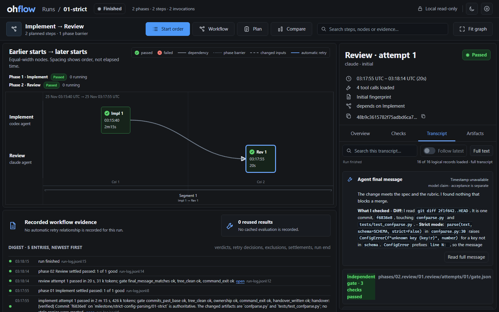

# ohflow

ohflow runs agent work as a plan you can inspect, measure, resume and improve, on your own
machines and on cloud agents. It is for people who already do substantial work with Claude Code or
Codex and want several agents on one change, with evidence behind every result.

**Every run leaves evidence you can read.** A run writes a run log, serves a live dashboard and
ends with an exit report that gives each agent's time, tokens and gate result. An agent's final
message is a claim, so a gate checks the commit the agent left before the step passes. A stopped
run resumes from its run directory. A fresh judge agent reads the evidence after each milestone
and sends the milestone back with revised briefs when the result misses the bar.

**One plan places the work on your machines and in the cloud.** You give the goal and the limits.
Your agent, the orchestrator agent, proposes who does what where, and writes the plan as a spec
bundle that names a box and a harness for each step. ohflow runs each step with Claude Code, Codex or pi on this machine, with
pi-durable on your other machines over ssh, or with Claude Code, Codex or pi in containers behind a
Cloudflare Worker that you deploy.



The quickstart's first milestone, from [the run below](#the-run-behind-the-screenshot). Codex wrote
the change in 2 min 15 s and Claude Code reviewed it in 20 s. The right panel marks the reviewer's
verdict as a model claim, beside the independent gate that checked the commit.

## How it works


1. You state the goal and the limits: which machines may run steps, which data may leave them and
   which subscriptions the work may spend.
2. The orchestrator agent reads your specs with its own connectors, such as an issue tracker, `gh` or a folder.
   It writes a spec bundle: one `spec.md` per milestone, each with its workflow pattern, its
   box and harness, and its acceptance checks.
3. `ohflow construct` turns the bundle into a campaign and derives each step's harness executor
   from its box and harness. It prints every milestone's steps and executors, so you read the plan
   before anything runs. `campaign run --hold` waits for your `ohflow go`.
4. The campaign controller runs the milestones in order. For each one, the engine runs the phases,
   retries a failed step, merges the branches and keeps to the parallel limit. Each agent step
   works in its own git worktree.
5. A gate checks each step's commit: a command's exit code, a clean tree, the paths the step was
   allowed to write.
6. A fresh judge agent reads the run's evidence and the acceptance checks. PASS moves the
   integration branch forward. REVISE commits the judge's new briefs and resumes the milestone.
   ESCALATE stops the campaign and asks you.

| Box in the bundle | Harness | Harness executor | Where the agent runs |
|---|---|---|---|
| `local` | `claude`, `codex` or `pi` | `claude`, `codex` or `pi` | a child process on this machine |
| `local`, with `durable: yes` | `pi` | `durable` | pi-durable on this machine, so the step survives a restart of ohflow |
| an ssh host alias | `pi` | `durable` | pi-durable on that machine |
| `cloud` | `claude`, `codex` or `pi` | `claude-cloud`, `codex-cloud` or `pi-cloud` | a container behind your Cloudflare Worker |

### What the plan decides

- A step runs on the box and with the harness that its bundle names. ohflow does not move work
  between machines by load or free capacity.
- A machine over ssh runs pi steps through pi-durable. Claude Code and Codex steps run on this
  machine or in the cloud.
- Where a step runs, which model provider it calls and which git remote carries its commits are
  three separate choices. A pi step on your own machine still sends its prompts to the provider
  that its key belongs to.

## Quickstart: from a spec bundle to a finished change

This takes about ten minutes. The agents work for about five of them: the campaign in
[the run below](#the-run-behind-the-screenshot) took 5 minutes. You need:

- Python 3.11 or later as `python3`, git with a commit identity, and bash. On Windows, use Git Bash.
- Claude Code, signed in with `claude auth login`. For Codex or pi, see the note after the
  commands.

Clone ohflow and check that your harness works:

```bash
git clone https://github.com/esinecan/ohflow
cd ohflow/scripts
export PYTHONPATH=.
python3 -m ohflow.cli preflight --harness-executors claude
```

The first line must read `PREFLIGHT PASS: 2 checks`. A `FAIL` line names its fix.

`examples/quickstart/` holds a small config parser in `app/` and a spec bundle in `specs/`. The
specs ask for a strict mode in the parser and a README section about it, as two milestones. Copy
the example and make the app a git repository:

```bash
QS=~/ohflow-quickstart
cp -r ../examples/quickstart "$QS"
git -C "$QS/app" init -q -b main
git -C "$QS/app" add -A
git -C "$QS/app" commit -qm "the app before the change"
```

Build the campaign, read what it prints, then start it and watch it:

```bash
python3 -m ohflow.cli construct --bundle "$QS/specs" --out "$QS/campaign"
python3 -m ohflow.cli campaign run --campaign "$QS/campaign/campaign.py" --detach
python3 -m ohflow.cli campaign watch --campaign "$QS/campaign/campaign.py" --timeout 600
```

`construct` prints one line per milestone with its steps and harness executors, then
`CAMPAIGN OK` and the command that starts the campaign. `campaign watch` waits for news and prints it, with each run's dashboard address
while that run is live. Run it again until its first line ends with `delivered`.

Read the result:

```bash
git -C "$QS/app" log --oneline campaign/strict-config-parsing
python3 -m ohflow.cli campaign history --campaign "$QS/campaign"
```

The branch `campaign/strict-config-parsing` holds one commit per milestone, and `main` stays as it
was. Each milestone's exit report is `exit-report.md` in its run directory,
`$QS/campaign/milestones/<id>/runs/<id>/`.

To run on Codex or pi, change `claude` to `codex` or `pi` in four lines before you run
`construct`: `judge harness` in `specs/bundle.md`, `harness` and `review harness` in
`specs/milestones/01-strict/spec.md`, and `harness` in `specs/milestones/02-docs/spec.md`. With
the model tiers in `ohflow.settings.json`, a pi step reads its key from `ZAI_API_KEY`.
[Model tiers](references/harness-executors.md#model-tiers) explains how to map a tier to another
model.

## The run behind the screenshot

On 25.11.2026 this quickstart ran on a Windows machine with one line changed: `harness: codex` for
the implementer of `01-strict`. Five minutes after the start, both milestones were on the
integration branch, and each judge had passed its milestone in the first round.

| Milestone | Steps | Tokens | Judge |
|---|---|---|---|
| `01-strict` | Codex implemented in 2 min 15 s, then Claude Code reviewed in 20 s | 457.8 k | PASS, round 1 |
| `02-docs` | Claude Code wrote the README section in 38 s | 454.7 k | PASS, round 1 |

The first milestone's exit report is [docs/example-run/exit-report.md](docs/example-run/exit-report.md).
Most of the tokens are cached input: 394 k of the implementer's 422 k, and 409 k of the docs
writer's 453 k. Each of those two agents ran in its harness's usual setup on that machine, with
the operator's own instructions, memory and tools. The reviewer ran hermetic, without that setup,
and read 30 k.

## With your agent

ohflow is an Agent Skill, and [SKILL.md](SKILL.md) is its entry point for your agent. Install it
with the [skills CLI](https://skills.sh) from the `release` branch. That branch only moves to a
commit from `main` after the commit passes the test suite and the package checks, as
[validated releases](docs/release/automation.md) explains.

```bash
npx skills add https://github.com/esinecan/ohflow/tree/release
```

The CLI needs Node 22.20 or later. It asks which agents to install for, or you name them with
`-a claude-code`, `-a codex` or both. It installs into the current project, and `-g` installs for
your user instead. Later, `npx skills update` moves the install to the newest release. To stay on
one release, install its tag from [the releases page](https://github.com/esinecan/ohflow/releases),
such as `https://github.com/esinecan/ohflow/tree/ohflow-v0.0.29`, and `update` leaves it there.

Two shorter forms do something else. `npx skills add esinecan/ohflow` installs the newest commit on
`main`, which may not have passed the release checks yet. `esinecan/ohflow@ohflow-v0.0.29` installs
nothing, because the CLI reads the part after `@` as a skill name.

You can also clone the `release` branch where your harness loads skills, for example
`git clone -b release https://github.com/esinecan/ohflow ~/.claude/skills/ohflow` for Claude Code.

With ohflow installed, give your agent the goal, the limits and the specs, and ask it to deliver
them with ohflow. The agent writes the bundle, shows you what `construct` prints, and runs and
watches the campaign.

## Glossary

[CONTEXT.md](CONTEXT.md) defines every term, and `docs/glossary-map.html`, opened in a browser,
teaches them through one example. The terms on this page:

| Term | Meaning |
|---|---|
| campaign | a spec bundle or a design delivered milestone by milestone, one workflow per milestone, with a fresh judge after each |
| milestone | one slice of the work, with its specification and acceptance checks |
| spec bundle | the folder `construct` reads: `bundle.md` and one `milestones/<id>/spec.md` per milestone |
| judge | the fresh agent that passes a milestone, revises it or escalates one question to you |
| workflow | phases of steps, run one phase after another |
| step | one piece of work in a phase: an agent, a command, a gate or a merge |
| gate | the checks a step must pass, run as code and never by an agent |
| harness | the program that runs the agent loop: Claude Code, Codex or pi |
| harness executor | the part of ohflow that starts, watches and stops one kind of harness |
| box | the machine or container where an attempt's commands run |
| workspace | a git repository that a workflow works on |
| worktree | the git working directory one step edits |
| run log | `run-log.jsonl`, the append-only record of what the engine did |
| exit report | `exit-report.md` and `exit-report.html`, written when a run ends |

## Where to go next

- [references/quickstart.md](references/quickstart.md) covers the prerequisites in detail, local
  settings, and a first roll call on each harness.
- [references/construct.md](references/construct.md) gives the spec bundle format and the six ways
  a milestone can arrange its steps.
- [references/campaign.md](references/campaign.md) explains how a campaign judges, revises and
  lands.
- [references/harness-executors.md](references/harness-executors.md) lists what each of the seven
  harness executors needs.
- [references/pi-cloud-worker.md](references/pi-cloud-worker.md) deploys the Cloudflare Worker for
  the cloud executors.
- [CONTRIBUTING.md](CONTRIBUTING.md) holds the module map and the test suite, for people who change
  ohflow.

## Roadmap

- **Capped loop.** A workflow will repeat one or more phases until a stop command says the work is
  done, and will stop early when a progress number, such as the count of failing tests, stops
  improving or the loop reaches its cap.
- **Run trace.** Each run will export one OpenTelemetry trace, with spans for the run and for each
  phase, step and attempt, which any OpenTelemetry viewer can open.

## License

ohflow is licensed under the Apache License, Version 2.0. The full text is in [LICENSE](LICENSE).
